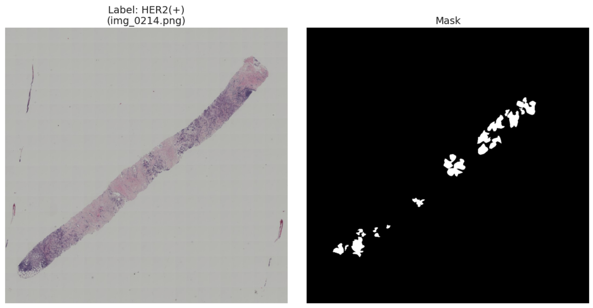

# Breast Cancer Molecular Subtype Classification using Domain-Specific Foundation Models

This repository contains the deep learning solution developed by **NoNameTeam** for the **Artificial Neural Networks and Deep Learning (AN2DL)** Second Challenge at **Politecnico di Milano** (A.Y. 2025/2026).

---

## Overview

This project tackles the classification of diseased human tissue samples into four breast cancer molecular subtypes: **Luminal A**, **Luminal B**, **HER2(+)**, and **Triple Negative**. The dataset consists of 1,272 high-resolution histological images of varying dimensions, each paired with a binary Region-of-Interest (ROI) mask highlighting the diagnostic tissue areas, evaluated according to the **Weighted F1-Score**.



Our approach prioritizes **mask-guided spatial tiling**, **domain-specific self-supervised Vision Transformers (Phikon)**, and **multi-view Test-Time Augmentation (TTA)**, demonstrating that preserving cellular resolution and leveraging pathology-pretrained representations are critical for small, imbalanced medical datasets.

---

## Key Challenges

Initial exploratory data analysis (EDA) revealed three primary bottlenecks:

* **Contamination & Duplicates**: The raw training set contained 224 outlier and duplicate images, which were filtered out via an automated inspection script, reducing the clean training pool to **464 samples** (plus **117 validation samples** via an 80/20 stratified split, and **477 test samples**).
* **Severe Spatial Sparsity**: Whole-slide images featured varying resolutions and vast sterile background regions. Naively downsampling full masked images to standard network input sizes destroyed the fine-grained cellular morphology required to distinguish subtypes.
* **Strong Class Imbalance**: The cleaned dataset exhibited a skewed distribution typical of clinical cohorts, with *Triple Negative* accounting for less than 12% of samples:

| Class ID | Molecular Subtype | Occurrences | Percentage |
| --- | --- | --- | --- |
| **0** | **Luminal A** | 163 | 35.13% |
| **1** | **Luminal B** | 126 | 27.16% |
| **2** | **HER2(+)** | 120 | 25.86% |
| **3** | **Triple Negative** | 55 | 11.85% |
| **Total** |  | **464** | **100.00%** |

---

## Data Preprocessing Pipeline

To overcome resolution loss and background sparsity, we implemented a custom PyTorch dataset module centered on **Positive-Pixel Mask-Guided Tiling**:

1. **Positive-Pixel Sampling**: For each image, the binary mask is loaded and queried for positive tissue coordinates. A positive pixel is randomly sampled as the crop center.
2. **High-Resolution Patch Extraction**: A full-resolution `224x224` crop is extracted around the sampled tissue coordinate, with automatic boundary clamping to prevent off-edge artifacts.
3. **Dynamic Multi-Crop Expansion**: During training, multiple random patches are generated per image at every epoch, expanding the effective training set size while acting as implicit spatial augmentation.
4. **Staining & Morphological Augmentation**: Applied robust data augmentation followed by standard normalization to simulate histological staining variability and improve generalization.

---

## Model Architecture

Given the small sample regime and specialized domain, we progressed from custom CNNs and ImageNet-pretrained backbones (**MobileNetV3**, **EfficientNet**, **ConvNeXt**, **ResNet50**) to a domain-specific pathology foundation model:

- **Domain-Specific Vision Transformer (`PhikonPathology`)**:
  - Leveraged **Owkin Phikon**, a Vision Transformer pre-trained via self-supervised masked image modeling on millions of histopathology patches.
  - Extracted the class token representation from the transformer backbone and attached a regularized classification head featuring dropout and linear projection layers.
- **ResNet50 Baseline**:
  - Utilized `IMAGENET1K_V2` weights with a two-layer bottleneck classifier head: `Linear(2048 -> 512) -> ReLU -> Dropout(p=0.4) -> Linear(512 -> 4)`.


---

## Training, Regularization & Multi-View Inference

To prevent overfitting and maximize generalization on unseen slides, we employed a **two-stage training protocol** paired with **Multi-View Soft Voting**:

* **Stage 1 — Transfer Learning (Linear Probing)**: Froze the pretrained backbone weights and trained the classification head using AdamW or Adam optimizers with weight decay under automatic mixed precision.
* **Stage 2 — Partial Backbone Fine-Tuning**: Unfroze the highest-level semantic backbone blocks and fine-tuned end-to-end with a reduced learning rate and early stopping based on validation weighted F1 performance monitoring.
* **Imbalance Handling**: Applied **Class-Weighted Cross-Entropy Loss** based on inverse class frequencies, which outperformed minority oversampling in validation ablation studies.
* **Multi-View TTA Inference**: At test time, each image is evaluated across multiple random mask-guided crops. Softmax probability vectors are summed and averaged across all views via soft voting to determine the final subtype prediction.

---

## Results

Performance comparison across our primary architectures on the stratified validation set and the final Kaggle leaderboard:

| Model Architecture | Pre-training Domain | Validation Accuracy | Validation Precision | Validation F1 (Weighted) | Test F1 Score (Kaggle) |
| --- | --- | --- | --- | --- | --- |
| **EfficientNet** | ImageNet | 34.98% | 37.53% | 0.4548 | 0.3694 |
| **ResNet50 + Tiling** | ImageNet1K_V2 | **35.90%** | **37.94%** | **0.5052** | 0.3850 |
| **Phikon + 10-View Tiling (Final)** | Histopathology SSL | 35.04% | 37.69% | 0.4613 | **0.3970** |

> **Interpretability & Error Analysis**: Class Activation Mapping (CAM) and high-loss sample inspection confirmed that the mask-guided tiling strategy effectively directs model attention toward dense cellular structures rather than background artifacts, though rare subtypes with subtle morphological boundaries (*Triple Negative*) remain the primary source of classification loss.

---

## Repository Structure

```text
.
├── AN2DL_NoNameTeam_Challenge2_notebook_best_phikon.ipynb  # ★ Final Phikon ViT pipeline (Transfer Learning, Fine-Tuning & Multi-View TTA)
├── AN2DL_NoNameTeam_Challenge1_notebook_resnet.ipynb       # ResNet50 pipeline (Transfer Learning, Layer4 Fine-Tuning & 50-View TTA)
├── AN2DL_NoNameTeam_Challenge2_Report.pdf                  # 4-page technical report (IEEE format)
└── README.md                                               # Project documentation

```

---

## Team: NoNameTeam

[Pietro Ghersetich](https://www.linkedin.com/in/pietro-ghersetich/)

[Alessandro Mattiazzi](https://www.linkedin.com/in/alessandro-mattiazzi-2b9a48298/)

[Matteo Mugnai](https://www.linkedin.com/in/matteomugnai/)

[Tommaso Tron](https://www.linkedin.com/in/tommaso-tron-964162359/)

*Politecnico di Milano — Artificial Neural Networks and Deep Learning (December 2025)*
